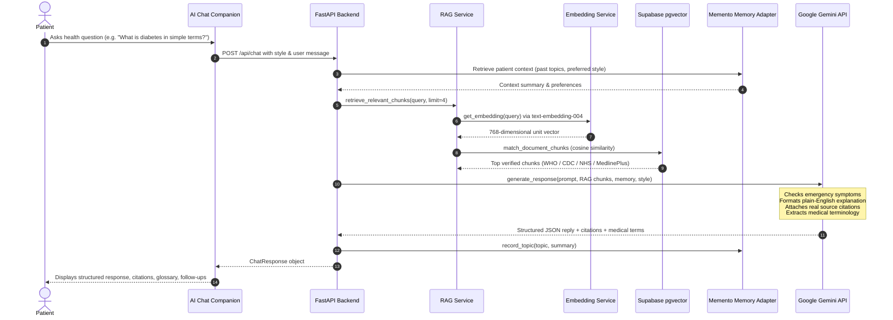

# CareGuide AI – System Architecture Documentation

CareGuide AI is a production-minded Generative AI healthcare education platform that helps patients understand publicly available healthcare information through simple, personalized explanations.

Strict Educational Scope: The platform is strictly for general health education, NOT individual medical diagnosis, acute emergency triage, or prescribing medication.

---

## 1. High-Level System Architecture

```mermaid
graph TD
    subgraph Client ["Frontend (Next.js 14 App Router)"]
        UI_Landing["Landing Page (/)"]
        UI_Auth["Supabase Auth (/login, /signup)"]
        UI_Dash["Patient Dashboard (/dashboard)"]
        UI_Chat["AI Chat Companion (/chat)"]
        UI_Prefs["Preferences & Memory (/preferences)"]
        UI_Sources["Knowledge Explorer (/sources)"]
    end

    subgraph Backend ["Backend API (FastAPI & Python 3.10)"]
        Router_Chat["Chat Router (/api/chat)"]
        Router_Prefs["Preferences Router (/api/preferences)"]
        Router_Memory["Memory Router (/api/memory)"]
        Router_Ingest["Ingestion Router (/api/ingestion)"]
        Router_Health["Health Diagnostic (/health)"]
        
        Service_RAG["RAG Service (Chunking & Retrieval)"]
        Service_Gemini["Gemini Service (Prompt Eng. & Safety)"]
        Service_Firecrawl["Firecrawl Service (Domain Enforcer)"]
        Service_Embedding["Embedding Service (text-embedding-004)"]
        Service_Memento["Memento Memory Adapter"]
    end

    subgraph Data ["Data & Storage Layer (Supabase)"]
        DB_Postgres["Supabase PostgreSQL"]
        DB_Vector["pgvector (768-dim HNSW Index)"]
        DB_Memories["patient_memories Table"]
        DB_Conversations["conversations & messages Tables"]
        DB_Auth["Supabase Authentication"]
    end

    subgraph External ["External AI & Extraction APIs"]
        Ext_Gemini["Google Gemini 1.5 / 2.0 API"]
        Ext_Embedding["Google text-embedding-004 API"]
        Ext_Firecrawl["Firecrawl Web Scraping API"]
        Ext_TrustedSources["WHO, CDC, NHS, MedlinePlus"]
    end

    %% Client to Backend
    UI_Chat -->|REST API & Bearer JWT| Router_Chat
    UI_Prefs -->|REST API| Router_Prefs
    UI_Prefs -->|REST API| Router_Memory
    UI_Sources -->|REST API| Router_Ingest
    UI_Auth -->|Auth Sessions| DB_Auth

    %% Backend Service Interactions
    Router_Chat --> Service_RAG
    Router_Chat --> Service_Gemini
    Router_Chat --> Service_Memento

    Router_Ingest --> Service_Firecrawl
    Router_Ingest --> Service_RAG

    Router_Memory --> Service_Memento

    %% Service to Storage & External
    Service_Firecrawl -->|Enforces Allowlist| Ext_TrustedSources
    Service_Firecrawl -->|Scrapes Structured Markdown| Ext_Firecrawl

    Service_RAG --> Service_Embedding
    Service_RAG --> DB_Vector
    Service_RAG --> DB_Postgres

    Service_Embedding --> Ext_Embedding

    Service_Gemini --> Ext_Gemini
    Service_Gemini --> DB_Conversations

    Service_Memento --> DB_Memories
    Service_Memento --> DB_Postgres
```

---

## 2. Ingestion & Retrieval-Augmented Generation (RAG) Flow

---

## 3. Trusted Domain Ingestion Allowlist

Firecrawl extraction is strictly constrained by domain validation logic in `firecrawl_service.py`:
- `who.int` — World Health Organization
- `cdc.gov` — Centers for Disease Control and Prevention
- `nhs.uk` — National Health Service
- `medlineplus.gov` — U.S. National Library of Medicine

Any URL outside these four domains is rejected with HTTP 400 Bad Request.

---

## 4. Memento Persistent Memory Specification

Per the system guidelines, Memento memory is integrated through a clean adapter interface `IMemoryAdapter`:
- **User Isolation**: Stored memories are strictly keyed to authenticated `user_id`.
- **Privacy Controls**: Users can inspect tracked topics and delete persistent records with one click (`DELETE /api/memory`).
- **Toggle Control**: Memory can be toggled on or off at any time.
- **Zero Sensitive Inferences**: Diagnostic labels are never inferred or saved from ordinary educational questions.

---

## 5. Clinical Safety Safeguards

1. **Non-Diagnostic Policy**: Never issues personalized diagnoses or clinical treatment orders.
2. **Emergency Detection**: Evaluates acute warning keywords (e.g., chest pain, shortness of breath, stroke signs) and immediately renders an emergency hotline notice (911/999/112).
3. **Medical Terms Clarification**: Jargon is explicitly defined in plain English with dedicated UI cards.
4. **Source Attribution**: Citations link to real URLs from the verified allowlist.
