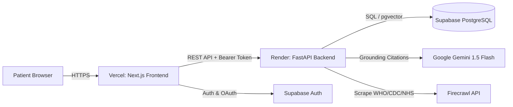

# CareGuide AI — Production Deployment Guide

This guide walks you through deploying **CareGuide AI** live to the web for free using:
- **Backend (FastAPI):** [Render](https://render.com) (or Railway / Fly.io)
- **Frontend (Next.js):** [Vercel](https://vercel.com)
- **Database & Auth:** [Supabase](https://supabase.com)

---

## Architecture Overview

---

## Step 1: Deploy Backend to Render (Free)

1. Sign up or log in at **[render.com](https://render.com)**.
2. Click **New +** $\rightarrow$ **Web Service**.
3. Select **Build and deploy from a Git repository**.
4. Connect your GitHub account and select your repository:
   `https://github.com/debmalyaa29/CareGuide-AI`
5. Configure the service settings:
   - **Name:** `careguide-ai-backend`
   - **Region:** Any (e.g. Frankfurt, Oregon, Ohio)
   - **Branch:** `feature/careguide-initial-upload` (or `main`)
   - **Root Directory:** *(leave blank or set to project root)*
   - **Runtime:** `Python 3`
   - **Build Command:** `pip install -r backend/requirements.txt`
   - **Start Command:** `uvicorn backend.app.main:app --host 0.0.0.0 --port $PORT`
   - **Plan:** **Free**
6. Scroll down to **Environment Variables** and add:
   | Key | Value |
   |---|---|
   | `PYTHON_VERSION` | `3.10.12` |
   | `ENVIRONMENT` | `production` |
   | `CORS_ORIGINS` | `*` (or your Vercel URL once generated) |
   | `GEMINI_API_KEY` | *(Your Google AI Studio API Key)* |
   | `GEMINI_MODEL` | `gemini-1.5-flash` |
   | `EMBEDDING_MODEL` | `models/text-embedding-004` |
   | `FIRECRAWL_API_KEY` | *(Your Firecrawl API Key)* |
   | `SUPABASE_URL` | *(Your Supabase Project URL)* |
   | `SUPABASE_ANON_KEY` | *(Your Supabase Anon Public Key)* |
   | `SUPABASE_SERVICE_ROLE_KEY` | *(Your Supabase Service Role Secret Key)* |
   | `MEMENTO_MEMORY_STORE` | `postgres_supabase` |

7. Click **Create Web Service**.
8. Render will build and deploy the backend. Once active, copy your live backend URL:
   `https://careguide-ai-backend-xxxx.onrender.com`
9. Test it by opening `https://careguide-ai-backend-xxxx.onrender.com/health` in your browser. You should see:
   `{"status":"healthy","database":"connected","vector_extension":"pgvector_ready"}`

---

## Step 2: Deploy Frontend to Vercel (Free)

1. Sign up or log in at **[vercel.com](https://vercel.com)**.
2. Click **Add New…** $\rightarrow$ **Project**.
3. Select your GitHub repository: `debmalyaa29/CareGuide-AI`.
4. In the configuration screen:
   - **Framework Preset:** `Next.js`
   - **Root Directory:** Click **Edit** and choose `frontend`.
   - **Build Command:** `next build` (default)
   - **Output Directory:** `.next` (default)
5. Expand the **Environment Variables** section and add:
   | Key | Value |
   |---|---|
   | `NEXT_PUBLIC_SUPABASE_URL` | `https://your-project.supabase.co` |
   | `NEXT_PUBLIC_SUPABASE_ANON_KEY` | `your-supabase-anon-key` |
   | `NEXT_PUBLIC_API_URL` | `https://careguide-ai-backend-xxxx.onrender.com` *(Backend URL from Step 1)* |

6. Click **Deploy**.
7. Vercel will build and assign you a production URL:
   `https://careguide-ai-xxxx.vercel.app`

---

## Step 3: Configure Supabase for Production URL

To enable Supabase Email and Google OAuth authentication on your live site:

1. Open your **[Supabase Dashboard](https://supabase.com/dashboard)**.
2. Go to **Authentication** $\rightarrow$ **URL Configuration**.
3. Set **Site URL** to your Vercel URL:
   `https://careguide-ai-xxxx.vercel.app`
4. Under **Redirect URLs**, add:
   - `https://careguide-ai-xxxx.vercel.app/auth/callback`
   - `http://localhost:3000/auth/callback` *(for continued local development)*
5. Click **Save**.

*(If using Google OAuth, also add `https://<your-supabase-id>.supabase.co/auth/v1/callback` in the Google Cloud Console Authorized redirect URIs).*

---

## Step 4: Update Backend CORS on Render

Once your Vercel URL is live:
1. Go to your Render backend service $\rightarrow$ **Environment**.
2. Update `CORS_ORIGINS` to:
   `http://localhost:3000,https://careguide-ai-xxxx.vercel.app`
3. Click **Save Changes** (Render will automatically redeploy with the strict origin policy).

---

## Verification Checklist

- [ ] `GET https://careguide-ai-backend.onrender.com/health` returns `200 OK`.
- [ ] Visiting `https://careguide-ai.vercel.app/` loads the landing page.
- [ ] Visiting `/chat` while logged out redirects to `/login?redirect=%2Fchat`.
- [ ] Logging in creates a verified session and routes back to `/chat`.
- [ ] Asking a healthcare question retrieves verified citations and saves memory to Supabase.
